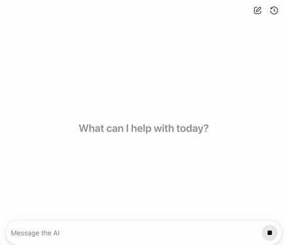

# LangGraph Shopping Assistant

Shopping assistant with agentic RAG over a product catalog, built with LangGraph.

<p>
  
</p>

## Run

```bash
cp .env.example .env    # fill in API keys
docker compose up -d    # http://127.0.0.1:8080
```

Needs the local, gitignored system prompt at `services/backend/prompts/shopping-assistant.md`. The first start loads the product feed into Qdrant (about a minute).

## Test

```bash
cd services/backend
uv run pytest                                              # db tests need the compose postgres
uv run python -m assistant.evals.suite openai/gpt-6-luna   # real model, cases in evals/
```
